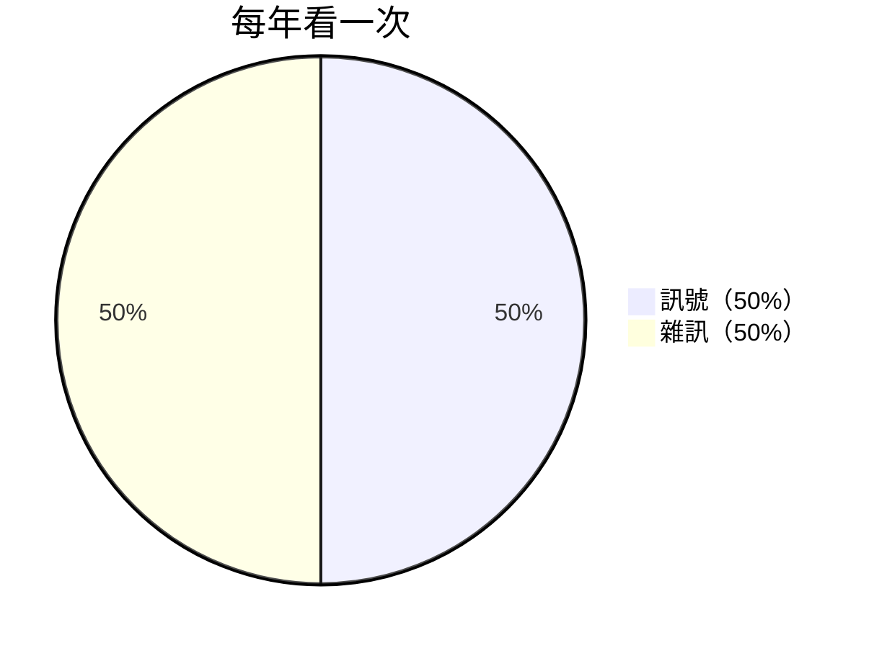
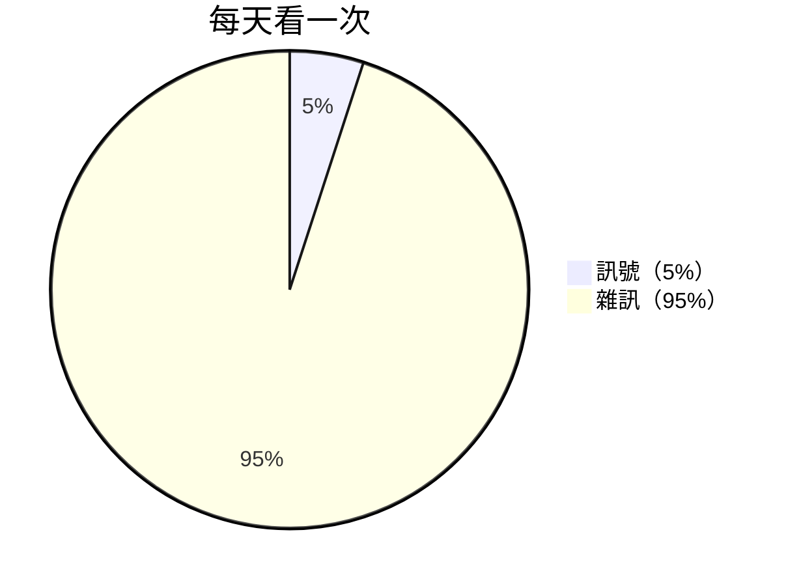
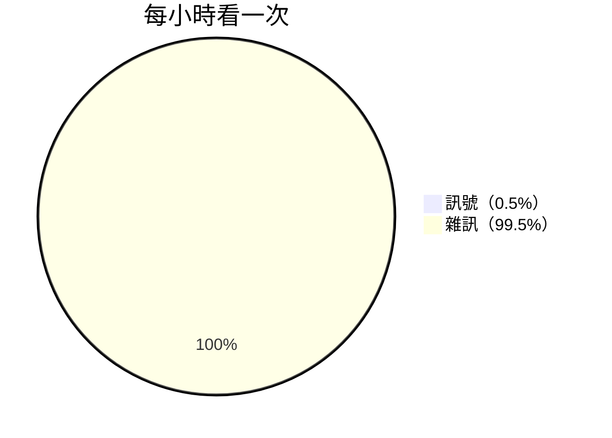

你有看新聞的習慣嗎？你是否曾經相信，看新聞是「負責任」的公民該做的事？

統計學家 [Nassim Nicholas Taleb](https://www.google.com/search?q=Nassim+Nicholas+Taleb) 在《[反脆弱](https://www.books.com.tw/products/0010590630)》（[Antifragile](https://www.goodreads.com/book/show/13530973-antifragile)）寫道：

> 你看數據的次數越頻繁，得到的雜訊就越多（而不是有價值的訊號）；因此，雜訊/訊號比就越高。
>
> The more frequently you look at data, the more noise you are disproportionally likely to get (rather than the valuable part called the signal); hence the higher the noise-to-signal ratio.

訊號通常持久、變化緩慢；雜訊則隨機、四處亂竄。所以，當我們看得越頻繁，捕捉到的雜訊就越多，雜訊/訊號比也就越高：

他接著寫道：

> 在網路時代，這件事很難被接受。我始終很難解釋 — 你得到的數據越多，反而越不知道發生了什麼事。
>
> This is hard to accept in the age of the Internet. It has been very hard for me to explain that the more data you get, the less you know what’s going on.

這讓我想到新聞：**看得越多，對世界的了解反而越少**。更何況，這世界每天發生的事，24 小時可能也不夠我們看完 0.0001%。

[研究](https://doi.org/10.1038/s41562-023-01538-4) 發現，新聞標題每多一個負面詞，點擊率就多 2.3%。「震驚」、「誇張」、「爆出」這些聳動字眼，並非為了傳遞資訊而生（不然幹嗎不直接寫重點？），而是騙你掉進點擊誘餌（clickbait）的陷阱，好讓平台多榨取收益。

[貝特里奇頭條定律](https://www.google.com/search?q=貝特里奇頭條標題定律)（Betteridge’s Law of Headlines）也說：任何以問號結尾的新聞標題，內容通常是胡說八道，只是記者用來侮辱智商、騙取點擊率的手法。

> 新聞對心靈的傷害，就像糖對身體一樣：好吃、好消化，卻傷人於無形。
>
> — [Rolf Dobelli](https://www.google.com/search?q=Rolf+Dobelli)，《[拒看新聞的生活藝術](https://www.books.com.tw/products/0010850742)》（[Die Kunst des digitalen Lebens](https://www.goodreads.com/book/show/48581422-stop-reading-the-news)）

看新聞，其實是一種「[外包思考](20260318.md)」的行為。不相信嗎？把新聞關掉一個星期，你會發現自己有很多「想法」，只是新聞標題。

世界盃誰贏了、川普今天說了什麼、iPhone 又推出什麼新功能。看新聞很像吃垃圾食物，餵得飽一時的興奮，卻餵不飽長遠的成長。我的經驗是，還會帶來一種說不上來的空虛感 ☹️

那怎麼辦？

_只吸收「歷久彌新」（Timeless）的內容 — 那些多年後依然適用、價值不減的知識，並忽略「當下即時」（Timely）的新聞。專注在不會變的事情，就不會被變來變去的東西搞得心神不寧。_

《[銀色馬](https://en.wikipedia.org/wiki/The_Adventure_of_Silver_Blaze)》（The Adventure of Silver Blaze）有個故事：

比賽前夕，備受矚目的冠軍賽馬離奇失蹤，馴馬師被發現陳屍在附近的荒野。大家忙著追查兇手，福爾摩斯卻對「狗沒叫」這件事起疑。

狗沒叫，代表來者是牠認識的人，也就是馴馬師本人。他為了賭局，趁夜想弄傷馬腳，反被受驚嚇的馬一腳踢死。

新聞也是這樣：**最該被大眾知道的，也許是那些「沒被報導」的消息。**

[帕金森瑣碎定理](https://en.wikipedia.org/wiki/Law_of_triviality)（Parkinson’s Law of Triviality）源自一個很有意思的觀察：

> 開會時，與會者兩分鐘就通過一千萬英鎊的核反應爐預算，卻為了幾百美元的員工腳踏車棚爭論一小時。

為什麼呢？因為人們對員工腳踏車棚有相當的認識，因此意見特別多；對於核反應爐，由於金額和技術含量都遠超過一般人的認知範圍，為避免失言，所以選擇沈默。

新聞也是如此：**議題受到關注的程度，通常和它的重要性成反比**。越淺顯的生活事件，越容易被報導；越複雜的關鍵問題，越容易因為難以理解，而乏人問津。

---

戒新聞不是件容易的事，因為安靜令人感到不安。畢竟，電視再吵，也比自己內心的聲音好聽，是吧？

那就聽取 [Taleb 的建議](https://www.goodreads.com/quotes/7588210-to-be-completely-cured-of-newspapers-spend-a-year-reading)，先從讀上星期的報紙開始吧！
